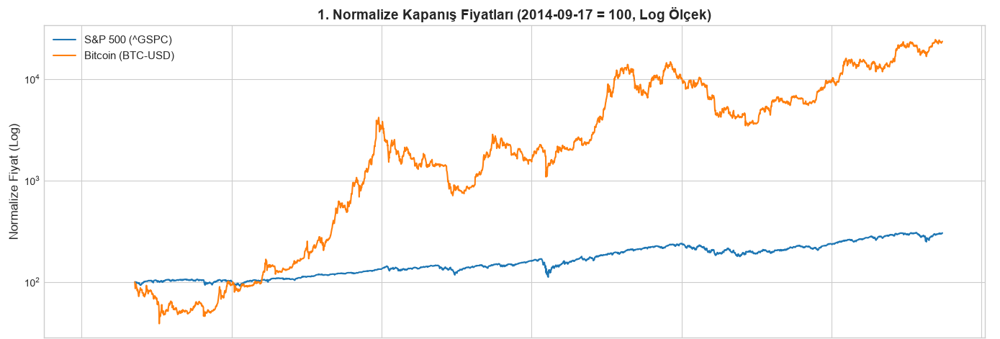
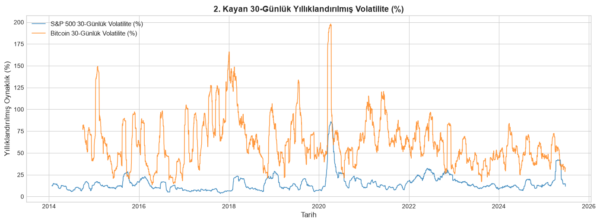
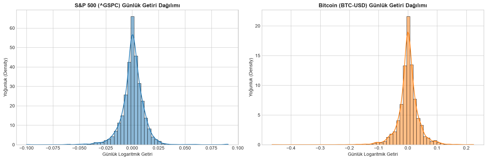

# Finansal Zaman Serisi Keşifsel Veri Analizi (Yahoo Finance EDA)

> **NOT:** Bu çalışma; geleneksel sermaye piyasası endeksleri (S&P 500) ile 7/24 işlem gören lider kripto varlığın (Bitcoin) 10 yıllık (2014–2024) tarihsel piyasa verileri üzerinden gerçekleştirilen **Bağımsız Finansal Zaman Serisi Keşifsel Veri Analizi (EDA)**, getiri dinamikleri ve oynaklık modellemesi pratiklerini sunmaktadır.

---

## 1. Giriş ve Veri Seti Mimarisi

Finansal zaman serileri; yüksek frekanslı piyasa gürültüsü, durağan olmama (*non-stationarity*), oynaklık kümelenmesi (*volatility clustering*) ve aşırı uç değerlere sahip ağır kuyruk (*fat-tailed*) dağılımları gibi klasik makine öğrenmesi algoritmalarını yanıltabilecek kritik zorluklar barındırır.

Bu çalışmada, iki zıt piyasa karakterini temsil eden varlıklar incelenmiştir:
- **S&P 500 (`^GSPC`)**: ABD borsa piyasalarının gösterge endeksi (Geleneksel sermaye piyasaları, yılda ~252 işlem günü).
- **Bitcoin (`BTC-USD`)**: Hafta sonu ve tatil tanımayan lider kripto para birimi (Dijital varlık piyasaları, yılda 365 işlem günü).
- **Zaman Aralığı**: 17 Eylül 2014 – 17 Eylül 2024 (10 Yıllık Kesintisiz Seri).
- **Kapsam**: 6.822 satır ham piyasa kaydı (Açılış, Yüksek, Düşük, Kapanış, Hacim).

---

## 2. Zaman Serisi Ön İşleme ve Fiyat Normalizasyonu

### 2.1. Fiyat Ölçekleme (100 Bazlı Endeksleme)

S&P 500 endeksi 2.000 – 6.000 USD bandında hareket ederken, Bitcoin aynı 10 yıllık dönemde 300 USD seviyelerinden 70.000+ USD seviyelerine ulaşmıştır. Farklı ölçek ve para birimlerindeki bu iki varlığın göreceli sermaye büyümesini tek bir eksende kıyaslayabilmek amacıyla **100 Bazlı Fiyat Normalizasyonu** uygulanmıştır:

$$P_{\text{norm}, t} = \frac{P_t}{P_0} \times 100$$

*Burada $P_0$, iki varlığın ortak başlangıç tarihi olan 17 Eylül 2014 tarihindeki ilk kapanış fiyatıdır.*

```python
import numpy as np
import pandas as pd
import matplotlib.pyplot as plt

# Varlık bazında ilk günkü fiyat 100 kabul edilerek göreceli büyüme oranı hesaplanır
df['norm_close'] = df.groupby('symbol')['close'].transform(lambda x: (x / x.iloc[0]) * 100)

# Normalize Fiyat Grafiği Oluşturma
plt.figure(figsize=(12, 6))
for symbol, group in df.groupby('symbol'):
    plt.plot(group['date'], group['norm_close'], label=symbol)
plt.title("100 Bazlı Normalize Fiyat Gelişimi (2014-2024)")
plt.xlabel("Tarih")
plt.ylabel("Normalize Fiyat (Baz=100)")
plt.legend()
plt.grid(True, alpha=0.3)
plt.show()
```



> **🔍 Analiz Bulgusu:**  
> S&P 500 10 yılda istikrarlı biçimde 100 bazından ~300 bazına yükselirken, Bitcoin logaritmik eksende 25.000+ seviyesine tırmanarak devasa makro piyasa döngüleri (2017 boğası, Mart 2020 likidite şoku, 2021 ve 2024 zirveleri) üretmiştir.

---

## 3. Logaritmik Getiri ($r_t$) ve Oynaklık (Volatilite) Modellemesi

### 3.1. Neden Ham Fiyat Değil de "Logaritmik Getiri"?

Ham fiyat serileri **durağan değildir (non-stationary)**; zamanla ortalaması ve varyansı değişir. Zaman serisi modellerinin ve istatistiksel testlerin geçerli olabilmesi için serinin durağanlaştırılması şarttır. Bu amaçla ardışık günler arasındaki **Logaritmik Getiri ($r_t$)** hesaplanmıştır:

$$r_t = \ln\left(\frac{P_t}{P_{t-1}}\right) = \ln(P_t) - \ln(P_{t-1})$$

```python
# Günlük logaritmik getirilerin hesaplanması
df['log_return'] = df.groupby('symbol')['close'].transform(lambda x: np.log(x / x.shift(1)))
```

> **💡 Metodolojik Not (Doğrusal Getiri vs. Logaritmik Getiri):**  
> Basit yüzdesel getiriler geriye dönük zamansal olarak toplanamaz (örneğin %10 artışın ardından gelen %10 düşüş sizi başa döndürmez, sermayenizi %99'a düşürür). Ancak logaritmik getiriler simetriktir ve zamansal olarak doğrudan toplanabilir niteliktedir ($\sum r_t$). Bu sayede istatistiksel ve ekonometrik analizlerde sapma oluşturmaz.

### 3.2. Yıllıklandırılmış 30 Günlük Hareketli Oynaklık

Piyasa risk rejimlerini anlık izleyebilmek için 30 günlük kayan pencerede (*rolling window*) standart sapma hesaplanmış ve işlem takvimlerine göre yıllıklandırılmıştır:

- **Geleneksel Piyasalar**: Hafta sonları ve resmi tatillerde kapalıdır ($\sqrt{252}$ çarpanı kullanılır).
- **Kripto Piyasalar**: 365 gün kesintisiz açıktır ($\sqrt{365}$ çarpanı kullanılır).

$$\text{Yıllık Volatilite}_{\text{S\&P 500}} = \sigma_{30} \times \sqrt{252} \times 100$$
$$\text{Yıllık Volatilite}_{\text{BTC}} = \sigma_{30} \times \sqrt{365} \times 100$$

```python
# İşlem gün sayısına göre yıllıklandırılmış hareketli volatilite hesabı
def calculate_annualized_volatility(series, annual_trading_days, window=30):
    # Takvim boşluklarından etkilenmemek için eksik değerler temizlenir
    clean_series = series.dropna()
    rolling_std = clean_series.rolling(window=window, min_periods=15).std()
    return rolling_std * np.sqrt(annual_trading_days) * 100

# S&P 500 için (252 gün)
sp500_vol = calculate_annualized_volatility(df[df['symbol']=='^GSPC']['log_return'], 252)

# BTC-USD için (365 gün)
btc_vol = calculate_annualized_volatility(df[df['symbol']=='BTC-USD']['log_return'], 365)
```

> **⚠️ Kritik Veri Mühendisliği Notu:**  
> S&P 500 takviminde hafta sonu ve tatil boşlukları olduğu için, veriler tek bir tabloda birleştirildiğinde doğrudan `.rolling()` uygulanırsa hafta sonu boşlukları pencereye girerek sonraki tüm hesaplamaların `NaN` olmasına yol açar. Bu hatayı engellemek adına her varlık kendi işlem günlerinde bağımsız olarak `.dropna()` yapıldıktan sonra kayan pencereye tabi tutulmalıdır.



### 3.3. Volatilite Bulguları
- **Bitcoin Volatilitesi**: Normal dönemlerde ortalama **%40 – %80** bandında seyrederken, kriz anlarında **%200** seviyelerine tırmanır.
- **S&P 500 Volatilitesi**: Ortalama **%10 – %20** bandındadır (Mart 2020 COVID-19 krizinde tepe noktası %85 olmuştur).
- **Sayısal Karşılaştırma**: Bitcoin'in yıllıklandırılmış oynaklığı S&P 500'e kıyasla ortalama **3.29 kat daha yüksektir**.

---

## 4. İstatistiksel Dağılım Analizi (Skewness & Excess Kurtosis)

Finansal getirilerin normal (Gauss) dağılıma uyup uymadığını ve ekstrem uç değer (*fat-tail*) risklerini saptamak için dağılımın 3. ve 4. momentleri hesaplanmış ve yoğunluk grafikleri (KDE) çizdirilmiştir:

$$\text{Skewness} = E\left[\left(\frac{X-\mu}{\sigma}\right)^3\right], \quad \text{Excess Kurtosis} = E\left[\left(\frac{X-\mu}{\sigma}\right)^4\right] - 3$$

```python
from scipy.stats import kurtosis, skew
import seaborn as sns

sp500_returns = df[df['symbol']=='^GSPC']['log_return'].dropna()
btc_returns = df[df['symbol']=='BTC-USD']['log_return'].dropna()

print(f"S&P 500 Skewness: {skew(sp500_returns):.4f}, Excess Kurtosis: {kurtosis(sp500_returns):.4f}")
print(f"Bitcoin Skewness: {skew(btc_returns):.4f}, Excess Kurtosis: {kurtosis(btc_returns):.4f}")
```



### İstatistiksel Sonuçlar ve Metrikler
| Varlık | Çarpıklık (Skewness) | Aşırı Basıklık (Excess Kurtosis) | Dağılım Karakteristiği |
|---|---|---|---|
| **S&P 500** | -0.065 | **11.896** | Nötr simetri, aşırı kalın kuyruk (ani çöküş şokları) |
| **Bitcoin** | **-0.714** | **11.483** | Belirgin sol çarpıklık (sert düşüş eğilimi) ve aşırı kalın kuyruk |

1. **Sol Çarpıklık (Negative Skewness)**: Özellikle Bitcoin getirilerinde belirgin negatif çarpıklık gözlenmiştir. Bu durum piyasa yükselişlerinin zamana yayılarak yavaş gerçekleştiğini, ancak düşüşlerin ani, panik kaynaklı ve sert olduğunu ampirik olarak kanıtlar.
2. **Aşırı Basıklık (Leptokurtic / Fat-Tails)**: Her iki varlıkta da Excess Kurtosis değeri **11'in üzerindedir** (Normal dağılımda bu değer 0'dır). Bu durum, finansal piyasalarda "sabit varyans" ve "normal dağılım" varsayımlarının kesinlikle geçersiz olduğunu; ekstrem piyasa olaylarının (Black Swan) Gauss eğrisinin öngördüğünden yüzlerce kat daha sık gerçekleştiğini gösterir.

---

## 5. Çıkarılan Metodolojik Kazanımlar ve EDA Sonuçları

1. **İşlem Takvimi Uyumlaştırması**: Farklı piyasalara ait zaman serileri kıyaslanırken takvim farklılıkları yapay eksik değerler (`NaN`) üretir. Kayan pencere hesaplamaları her varlığın kendi aktif işlem günlerinde yürütülmelidir.
2. **Risk Ölçeklendirme**: Yıllıklandırılmış volatilite hesaplamalarında her piyasanın kendi işlem frekansı ($\sqrt{252}$ vs $\sqrt{365}$) kullanılmalıdır.
3. **Dinamik Eşik İhtiyacı**: Sabit varyans ve normal dağılım varsayımı finansal piyasalarda geçerli değildir; risk izleme sistemleri Levene testi gibi varyans homojenliği kontrolleri ve dinamik rejim eşikleri ile desteklenmelidir.
